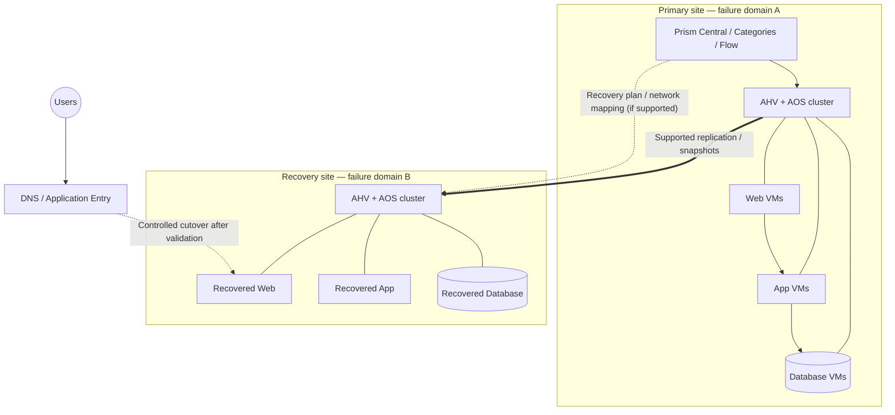

# Nutanix Hybrid Multicloud Disaster Recovery Blueprint

**Enterprise reference architecture | Nutanix AOS · AHV · Prism Central · Flow Network Security · Disaster Recovery**

> **Status:** Design reference; not deployed or validated against a live Nutanix environment. RPO/RTO are illustrative objectives, not guarantees. Confirm feature licensing, release compatibility, cluster sizing, connectivity, and API schemas before implementation.

## Executive summary

This blueprint models a two-site Nutanix environment supporting a three-tier business application. The architecture combines HCI, identity/category-based microsegmentation, application-aware recovery sequencing, isolated failover tests, and documented operational decision points. It separates **recovery requirements** from the **selected Nutanix protection mechanism** so that unsupported combinations are not implied.

### Business requirements and illustrative SLOs

| Requirement | Design target | Validation |
| --- | --- | --- |
| Business continuity | Recover tiered application at alternate site | Scheduled isolated failover |
| RPO | 15 minutes, subject to supported NearSync configuration | Record observed replication lag |
| RTO | 2 hours | Timestamp full application validation |
| Security | Least-privilege web/app/database flows | Flow monitor logs and policy tests |
| Governance | Approval-gated failover and failback | Signed runbook evidence |
| Recovery safety | No accidental production IP/DNS collision | Isolated test networks |

## Logical architecture



## Design decisions

1. **Select DR mechanism per workload and release.** NearSync is a replication capability with specific prerequisites; legacy Protection Domains and Prism Central recovery plans/Leap are not interchangeable or automatically interoperable. See [ADR-001](docs/adr-001-dr-mechanism.md).
2. **Design for two distinct failure domains.** Avoid shared power/network/storage dependencies and verify site capacity for protected workload placement.
3. **Use category-driven Flow policy.** Begin with monitoring, observe legitimate traffic, then review and enforce explicit allowlists. See [segmentation matrix](docs/flow-segmentation-matrix.md).
4. **Sequence recovery by dependencies.** Database integrity first, then application, then web/ingress; validate externally before DNS/routing cutover.
5. **Keep tests isolated.** Use nonproduction recovery networks and avoid conflicting identity, DNS, and database writes.
6. **Prove RPO/RTO.** Record actual snapshot timestamps, recovery timestamps, observed data loss, and application checks.

## Repository map

- [DR mechanism decision](docs/adr-001-dr-mechanism.md)
- [Disaster recovery runbook](docs/dr-runbook.md)
- [Flow segmentation matrix](docs/flow-segmentation-matrix.md)
- [Validation evidence template](docs/validation-evidence-template.md)
- [Application inventory](examples/application-inventory.yaml)
- [Recovery objectives](examples/dr-objectives.yaml)
- [Flow policy intent](policies/flow-intent.yaml)
- [Illustrative Flow v3 policy payload](policies/flow-isolation-v3-monitor.json)
- [Offline validation script](scripts/validate_blueprint.py)

## Validation workflow

```bash
python3 scripts/validate_blueprint.py
```

The offline validator checks required files and JSON syntax; it does **not** contact Prism Central or prove platform compatibility.

### DR exercise lifecycle

1. Inventory application dependencies, VM identifiers, IP mappings, protection requirements and owners.
2. Confirm site health, supported replication mode, policy consistency, and target capacity.
3. Capture baseline snapshot/replication state and application health.
4. Obtain change approval and establish rollback criteria.
5. Execute an **isolated test recovery** using the supported product workflow.
6. Validate DB consistency, application health, network controls, DNS behavior, and measured RPO/RTO.
7. Tear down test resources safely; preserve logs and evidence.
8. Review results, update runbook, and obtain production failover approval separately.

## Security and operational guardrails

No real customer data, IP addresses, secrets, tokens, or credentials belong in this repository. Flow API examples are **illustrative** and must be adapted to the actual Prism Central API version. Never POST a sample policy to production without a reviewed change plan. Production recovery and failback require vendor-supported procedures, dependency validation, and explicit authorization.

## References

- [Nutanix documentation](https://portal.nutanix.com/)
- [Nutanix developer API reference](https://www.nutanix.dev/api_reference/)
- [Nutanix training and certification](https://www.nutanix.com/support-services/training-certification)

**Author:** Darian O'Dirling · [Architecture portfolio](https://darianodirling.github.io/)